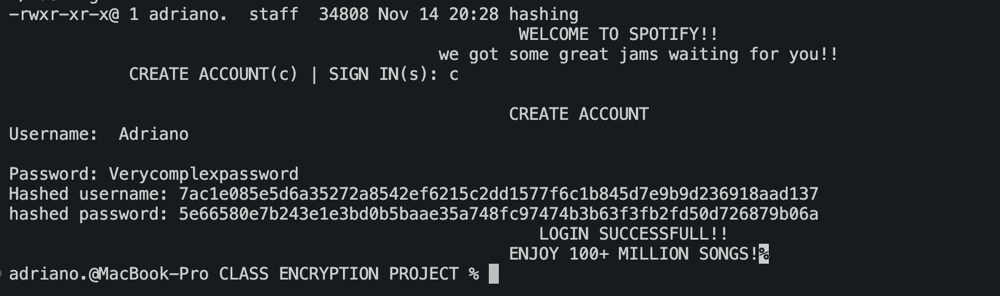
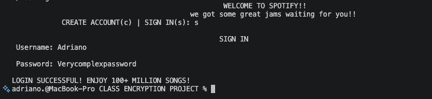
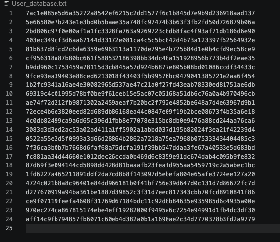

# Secure Login System

## What it does

- Create an account: takes a username and password, hashes both with SHA-256, finally it saves both to a `User_database`.
- Sign in: requests user for login information (username and 
- password), hashes them and compares it against the stored hashes.
- On failed login: offers to try again, create an account, or exit.
- Encrypts the whole user database at rest with AES-256-CBC (separate key file).

## Reason of creation

I created this project sophomore year to showcase my understanding of hashing and encryption, while building my knowledge of the C programming language.

## Security features

- Passwords never stored in plaintext, hashed using SHA-256.
- Database encrypted at rest with AES-256-CBC.
- Random IV generated per encryption, stored at the front of the file.

## Tech / library used

- C
- OpenSSL (`libcrypto`) for SHA-256 and AES

## How to build and run

```bash
gcc hashing.c -o hashing -lcrypto
./hashing
```

## Limitations

- My project only uses SHA-256 hashing so it's fast, but a real system would also use salting and a hash such as bcrypt or Argon2 for further complexity, making it a little slower.

## Lesson learned

Software companies encrypt and decrypt their database with a different key every time a user wants to login, adding another layer of complexity.

## Files in repo